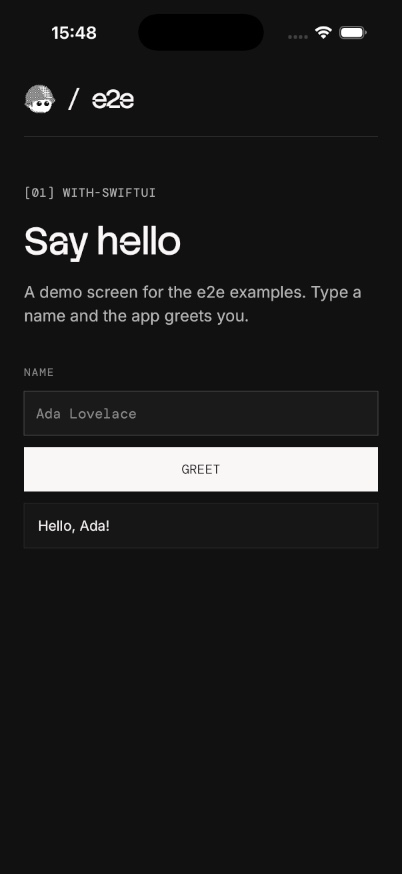
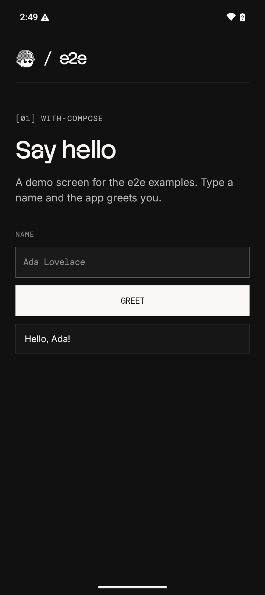

# Test iOS and Android apps with e2e and Limrun

Run the same five [e2e](https://e2e.tester.army) tests on a hosted iOS
simulator and Android emulator with [Limrun](https://limrun.com). This
repository includes a SwiftUI app, a Jetpack Compose app, and their shared
test suite. Limrun builds both apps remotely, so you need no local Xcode,
Gradle, simulator, or emulator. The tests use locators and need no AI key.

## Prerequisites

- Node.js 22.22.3+, 24.8+, or 26+, with npm.
- A [Limrun account](https://console.limrun.com) and an API key that can
  create and control iOS, Android, Xcode, and Gradle instances and manage assets.
  Builds and devices use your account's credits or plan minutes.
- For Android, [Android SDK Platform-Tools](https://developer.android.com/tools/releases/platform-tools)
  with `adb` on your `PATH`. Check with `adb version`.
- Git and `tar`. The shell commands below use Bash or Zsh.

## Build and run

1. Clone the example and install its pinned dependencies:

   ```sh
   git clone https://github.com/limrun-inc/e2e-limrun.git
   cd e2e-limrun
   npm ci
   ```

2. Set your API key in the current terminal:

   ```sh
   export LIMRUN_API_KEY='your-limrun-api-key'
   export LIM_API_KEY="$LIMRUN_API_KEY"
   ```

   The test provider reads `LIMRUN_API_KEY`; the build CLI reads `LIM_API_KEY`.

3. Build both apps on Limrun and download them into `build/`:

   ```sh
   npm run build
   ```

   The build scripts upload temporary assets that expire after 24 hours.
   Each build sandbox shuts down after one minute without activity.

4. Run the suite with video recording:

   ```sh
   npm test -- --video
   ```

   Expect five passing tests per platform. The provider creates and installs
   each target's device, reuses it for that target's tests, and releases it
   when the run exits. Abandoned devices have a one-hour lifetime limit.
   Reports, screenshots, and videos are saved under `.e2e/`.

To build and test just one platform:

```sh
npm run build:ios
npm test -- --target ios --video
```

```sh
npm run build:android
npm test -- --target android --video
```

## What the tests cover

Both apps show the same greeting form. [tests/greeting.e2e.ts](tests/greeting.e2e.ts)
checks these flows on both platforms:

| Flow | Expected result |
| --- | --- |
| Open the app | The heading, name field, and submit button appear. |
| Correct an empty submission | An error appears, then a valid name replaces it with a greeting. |
| Enter a name with surrounding spaces | The greeting trims the spaces. |
| Submit a second name | The new greeting replaces the previous one. |
| Restart the app | The form resets and an empty submission requires a name again. |

The tests select controls by their shared `name` and `greet` test IDs.
For example:

```ts
import { expect } from 'e2e';
import { test } from '@e2e-dev/mobile';

test('greets the entered name', async ({ app, screen }) => {
  await app.open();
  await screen.getByTestId('name').fill('Ada');
  await screen.getByTestId('greet').click();
  await expect(screen.getByText('Hello, Ada!', { exact: true })).toBeVisible();
});
```

The suite captures the successful greeting on both hosted devices:

| iOS | Android |
| --- | --- |
|  |  |

## Test your own app

In [e2e.config.ts](e2e.config.ts), change each target's `app.bundleId` and
`app.appPath` to match your builds. iOS needs a simulator `.app`; Android
needs an APK. You can also set `GREETING_IOS_APP` and `GREETING_ANDROID_APP`
to override the artifact paths while keeping these sample apps' bundle IDs.

Replace the greeting assertions with your app's flows. Use test IDs or
accessible names that both platforms expose. The sample submits by tapping
the button, so it does not depend on keyboard Enter support. Restarting
preserves persisted app data; these sample apps store the form in memory.

See the [e2e Limrun integration guide](https://e2e.tester.army/docs/integrations/limrun)
for provider options and the [Limrun documentation](https://docs.limrun.com)
for remote builds.

## Run in GitHub Actions

The repository checks TypeScript on pushes and pull requests. To run the
hosted devices from your fork, add a repository secret named
`LIMRUN_API_KEY`, then run the **Mobile tests** workflow from the **Actions**
tab. It builds both apps on Limrun, runs the tests on an Ubuntu runner, and
uploads the test reports and recordings. This workflow uses your Limrun
account's credits or plan minutes.

## Maintenance and license

Last checked on October 28, 2026 with e2e 0.21.3, mobile 0.12.4,
the Limrun provider 0.2.2, Limrun SDK 0.66.0, and Limrun CLI 0.48.0.
All ten tests passed on hosted iOS and Android devices with video recording.

The npm overrides select patched [Undici](https://github.com/nodejs/undici/security/advisories/GHSA-2m5v-pch6-74hx)
and [Zod](https://github.com/advisories/GHSA-mrhx-c7xc-m3w5) releases while
the upstream packages pin older versions.

Limrun maintains this example. [Open an issue](https://github.com/limrun-inc/e2e-limrun/issues)
for a broken setup or test. Before submitting a change, run
`npm run typecheck` and the affected platform's suite.

The apps and tests are adapted from
[TesterArmy's examples](https://github.com/tester-army/e2e/tree/main/examples).
Code is licensed under [Apache-2.0](LICENSE); see [NOTICE](NOTICE) for
attribution and the bundled font directories for their licenses.
